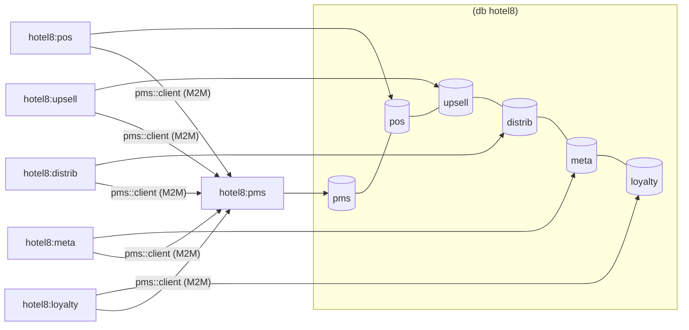
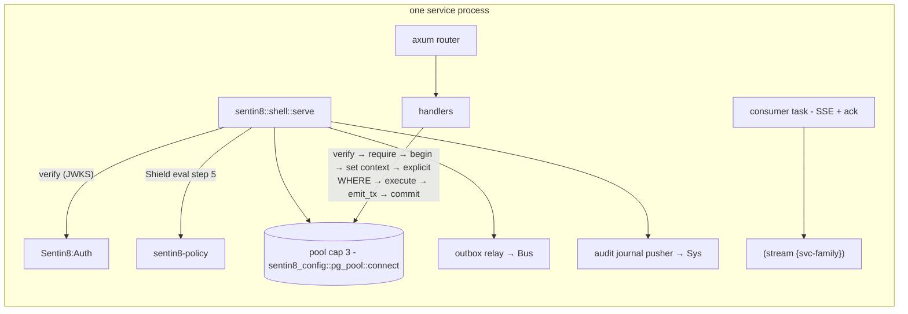
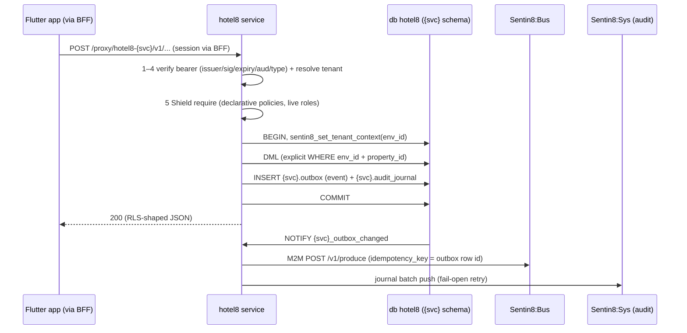
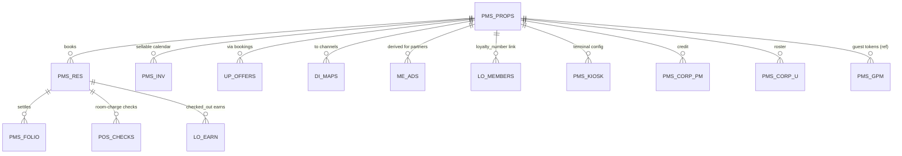
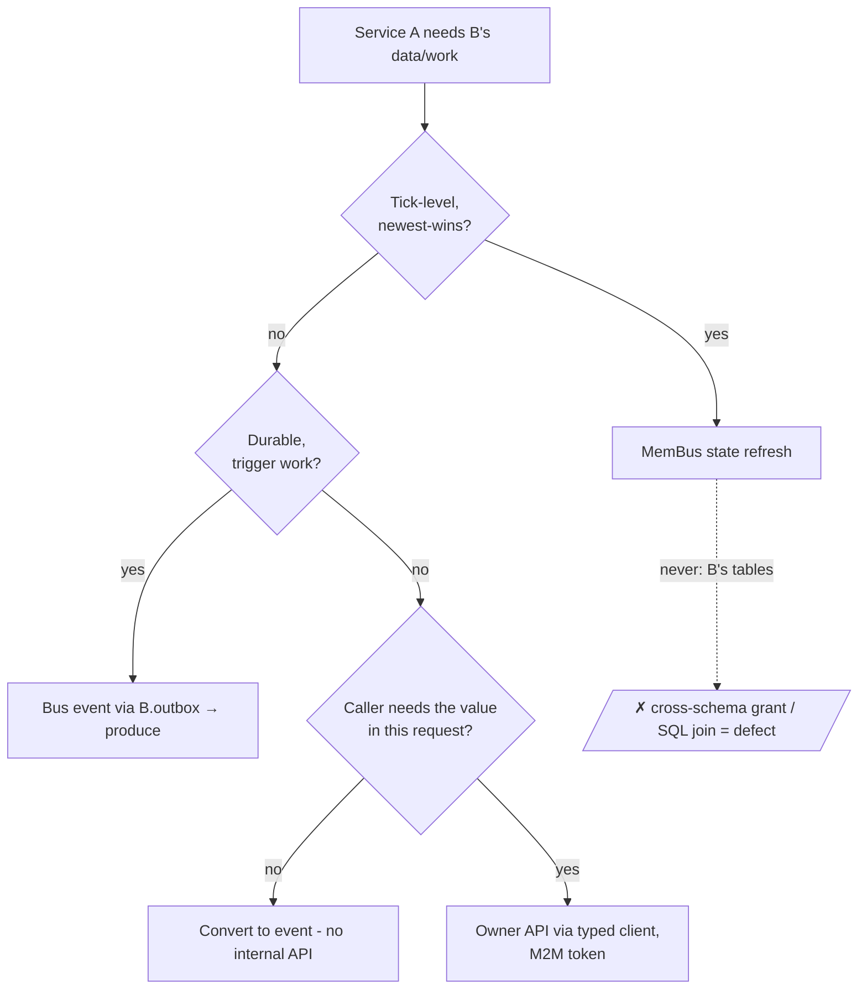

# hotel8 - Vertical Detailed Design

> Wire-level and architectural design of the whole hotel8 vertical. Per-service
> detail lives in `services/{svc}/DESIGN.md`; per-app detail in
> `apps/{app}/DESIGN.md`. This document covers the cross-service construction:
> boundaries, data topology, event flow, and the platform contracts every
> service shares.

## 1. Scope & Context

### Vertical boundary

**hotel8 owns**: the hospitality domain - properties/rooms/rates/reservations
(PMS), food-and-beverage operations (POS), offer generation (Upsell), channel
distribution (Distrib), metasearch connectivity (Meta), loyalty (Loyalty) -
each in its own schema of the shared vertical database `hotel8`, plus the six
Flutter apps. hotel8's crates (`crates/{svc}/{client,contracts}` and the
`sdk/rust/hotel8` namespace facade) are the typed integration surface.

**hotel8 does NOT own** (delegates to platform services):

| Concern | Owner |
|---|---|
| Identity, tokens, JWKS, M2M DCR | Sentin8:Auth (only issuer - vertical never mints credentials) |
| Client traffic + token custody | Sentin8:BFF (`/proxy/hotel8-{svc}/…`; apps never hold tokens) |
| Durable events | Sentin8:Bus (per-family streams, outbox-first produce) |
| Structured persistence / object storage | Sentin8:DB / Sentin8:Storage (never direct vendor SDKs in domain code) |
| Card capture & double-entry settlement | Bill8:Payments / Bill8:Ledger (via platform `sentin8` facade clients) |
| Email transport | Sentin8:Post |
| Scheduling / workflows / WASM hooks | Sentin8:Cron / Sentin8:Flow / Sentin8:Func |
| Ingress TLS, admin rendering | Sentin8:Proxy (SNI) / Sentin8:Dash (RFW host) |

### System context

```mermaid
graph TD
    subgraph hotel8v["hotel8 vertical (db hotel8 - schema per service)"]
        PMS[hotel8:pms]
        POS[hotel8:pos]
        UPS[hotel8:upsell]
        DIS[hotel8:distrib]
        MET[hotel8:meta]
        LOY[hotel8:loyalty]
    end
    subgraph platform["Sentin8 platform"]
        AUTH[Sentin8:Auth - only issuer]
        BFF[Sentin8:BFF - /proxy/*]
        BUS[Sentin8:Bus - streams]
        SYS[Sentin8:Sys - audit/orchestration]
        ING[Sentin8:Proxy - PQ-TLS ingress]
        POSTX[Sentin8:Post]
        CRON[Sentin8:Cron / Flow / Func]
    end
    APPS[6 Flutter apps] -- "BFF /proxy/* (session cookie)" --> BFF
    BFF -- "M2M + delegated tokens" --> PMS & POS & UPS & DIS & MET & LOY
    PMS & POS & UPS & DIS & MET & LOY -- "verify + Shield step 5" --> AUTH
    PMS -- "outbox → produce (M2M)" --> BUS
    POS & UPS & DIS & MET & LOY -- "outbox → produce; SSE consume" --> BUS
    PMS & POS & UPS & DIS & MET & LOY -- "audit journal push (M2M)" --> SYS
    PMS & POS & UPS -- "charges / balance-transactions" --> BILL[bill8:Payments+Ledger]
    DIS -. "ARI" .-> OTA[OTA/GDS channels]
    MET -. "rate ads / clicks" .-> MSA[Metasearch platforms]
    ING --> PMS & POS & UPS & DIS & MET & LOY
    CRON -- "scheduled triggers" --> UPS & PMS
    PMS -- "emails (templates)" --> POSTX
```

### Container view (vertical-internal)

Services are peers: no one hosts another, and no one holds another's database
grants. Integration is (a) events over Sentin8:Bus and (b) typed owner-API
calls through the `hotel8::{svc}::client` crates.

## 2. Runtime Architecture

Every service is the same construction (the shell pattern) - no per-service
scaffolding:

The 8-step authorization pipeline (architecture principles §5) runs
identically in all six services; tenant context is transaction-local
(`set_config(…, true)`), so every handler wraps its statements in
`pool.begin()` / `conn.commit()` - a pooled-connection context set outside an
explicit transaction dies before the first data statement (writes hit 42501,
reads silently return empty). This is enforced by convention and covered by
the DB-backed suite (`services/pms/tests/db_create_ops.rs`).

### Request lifecycle - one request, all steps

### Runtime-registered vertical surface

`vertical-registry.json` lists the six `service_type`s and six app slugs;
`sentin8-cli vertical enroll` provisions admin scopes, RFW admin pages,
M2M scope grants, Shield scope-mirror policy sets, error codes and the
captain catalog entries - nothing vertical-specific is hardcoded in the
platform, and nothing platform-specific is compiled into the vertical.
Service binaries self-describe via `--print-registration` sections.

## 3. Data Model (vertical topology)

One database `hotel8`; one schema per service; **no cross-schema grants**
(§6.6a - a cross-service table grant is a defect, not an access path). The
shell adds `{svc}.outbox` + `{svc}.audit_journal` per service.

Cross-service *conceptual* references (POS check → PMS reservation, loyalty
member → PMS profile) travel as **ids + snapshots inside event payloads** or
through owner-API reads - never as SQL joins, FKs, or schema grants.

**Schema files**: exactly one per service - `services/{svc}/sql/init.sql`,
declared as a single `SqlMigration { version: 1, name: "init" }`. The platform
tracks applied versions in `sys.vertical_migrations` (identity-key skip; no
checksums, no re-ordering) - and since this is a new platform there are no
migrations *at all*: schema changes edit `init.sql` and re-run
`make vertical-init`.

## 4. API Surface (vertical-level)

| Consumer → Provider | Path | Contract |
|---|---|---|
| Apps → service | `/proxy/hotel8-{svc}/v1/…` (BFF) | bearer delegated by BFF; Shield-gated |
| CLI/SDK → service | `https://hotel8-{svc}.{env}.{org}.{domain}` + `hotel8::{svc}::client` | M2M (cert-bound) or user token |
| Dash → service | `/proxy/hotel8-{svc}/v1/admin/ui/{page}` + `/v1/admin/{resource}` | RFW pages + data/submit aliases (`hotel8:pms` carries 14 pages) |
| Service → service | typed clients from `crates/{svc}/client` | see "Service access decision order" below |

Event families (all `vertical:service:resource:operation` with colons):
`hotel8:pms:*` (≈40 event types: reservation lifecycle, folio postings,
inventory, housekeeping, keys, kiosk/corporate config), `hotel8:pos:*`
(checks/orders/payments/reports), `hotel8:upsell:*`, `hotel8:distrib:*`,
`hotel8:meta:*`, `hotel8:loyalty:*`. Producers write `{svc}.outbox` in the
same transaction as the change; the shell relay pushes to Bus
(`POST /v1/produce`, M2M, idempotency key = outbox row id); consumers are
direct (per-service `event_consumer.rs` SSE + ack, consumer groups
`hotel8:{svc}:{purpose}`, at-least-once + idempotent handlers =
effectively-once; DLQ replay via Bus).

### Service access decision order - membus → bus → owner API

When service A needs something from service B, decide in this order
(AGENTS.md; architecture principles §4.7):

1. **MemBus state refresh** (`sentin8-membus`, newest-wins over Valkey) - for
   tick-level, ephemeral state. hotel8 today has **no MemBus consumers**:
   every cross-service need is either event-paced (bookings, checkouts, ARI)
   or request/response - a MemBus dependency would be ceremony, not latency.
2. **Sentin8:Bus domain event** (durable, audited, triggers work) - the
   vertical's default. PMS is the primary producer; POS (table-prep on
   `reservation:checked_in`), upsell (offer generation on
   `reservation:created`), loyalty (earning on `reservation:checked_out`),
   distrib and meta (ARI on `inventory:updated`) all consume the `pms` stream
   instead of polling.
3. **Owner HTTP API** - only for synchronous read-your-writes / validation
   that must block the caller: POS verifies in-house status before a
   room-charge payment; upsell/distrib/meta pull reservation inventory /
   profile snapshots and push channel bookings + reservation write-backs; POS
   posts room charges to PMS folios; loyalty links member numbers to PMS
   profiles. Every such call rides the typed client crate with an M2M token.
   **Never** another service's tables: no cross-schema grant, no FDW/dblink,
   no SQL join across service schemas. If a genuine need has no owner
   endpoint, the owner gains one - the caller never works around it.

## 5. Cross-Cutting Concerns (vertical-wide)

- **Identity** - one issuer (Sentin8:Auth); services verify tokens and
  authorize via Shield; the JWT `scope` is a pre-filter + RLS feed, the
  decision is live-resolved RBAC/ABAC/ReBAC (§5.2 principles). Service-to-
  service calls present the workload's Acme-issued certificate (auth DESIGN
  §4.3f - the TLS handshake IS the identity; no M2M token exists) via the
  shared `sentin8-m2m` crate's `ensure_workload_certificate`.
- **Tenant isolation** - every tenant table `ENABLE` + `FORCE ROW LEVEL
  SECURITY` with the standard `{schema}-schema` env-scoped predicate
  (`sentin8_context_initialized() AND env_id = sentin8_current_env_id()`);
  context is set per-transaction on the same connection as the query; explicit
  `WHERE env_id` / `WHERE property_id` clauses are defense-in-depth.
- **Idempotency** - outbox relay dedupes on row id; consumer handlers dedupe
  on event `idempotency_key`; posting batches carry unique idempotency keys.
- **Audit** - same-transaction `{svc}.audit_journal`, pushed to Sys
  `/v1/audit` (fail-open retry); no direct `audit_events` writes anywhere.
- **Secrets** - references only: payment instruments are bill8 token ids,
  meta partner credentials are encrypted rows, guest tokens never enter
  hotel8 tables.
- **TLS** - post-quantum only, in-process via `sentin8-tls`; no classical
  fallback, no `danger_accept_invalid_certs`, no hand-rolled CA loading.
- **Allocator** - the standard Rust system allocator; hotel8 deliberately
  ships no custom global allocator (platform profiling found no allocation
  pressure that justified the dependency, and uniform binaries beat tailored
  arenas across six small services).
- **E2E posture** - `e2e-ts` suites interact through the browser + BFF proxy
  only; no psql, no direct SQL, no direct backend calls in test code.

## 6. Failure Modes & Recovery

- **Outbox relay** - `NOTIFY` + 5s poll; attempts++ per failure; DLQ after
  max retries; replay via the Bus DLQ API. A Bus outage never drops a domain
  change (the outbox row *is* the durability).
- **Consumer crash** - at-least-once redelivery; idempotent handlers make it
  effectively-once; consumer lag visible in Bus admin.
- **PMS owner-API unavailable** - caller services degrade per feature: POS
  refuses room-charge payment (502, staff may switch payment method); upsell
  falls back to event-payload snapshots; distrib/meta retry ARI sync with
  their sync-log replay (`sync:retried` / `ari:sync`).
- **DB pool saturation** - capped pools (`sentin8_config::pg_pool::connect`,
  max 3 default); `make stop` frees connections when iterating.
- **Upgrade** - captain `upgrade-instance`: start new → wait `Active` → drain
  (health gauge) → stop old; never mixed-profile fleets (debug vs release).
- **Fresh-DB rebuild** - drop database → `make vertical-init` (applies each
  `init.sql` once) → `make vertical-enroll`. Old data is disposable by design.

## 7. Concurrency & Performance Model

- One tokio runtime per service; tasks: HTTP serve, consumer (SSE), relay,
  journal pusher (all shell-owned).
- Pool cap 3 per service (overridable `SENTIN8_PG_POOL_MAX`); ~20 platform +
  6 vertical services share one PostgreSQL 18 - the cap is what makes that
  safe.
- Hot paths: reservation create/search (PMS), order add during service (POS),
  offer generation on booking (upsell, zero call-back), ARI push (distrib).
  All are short transactions with in-memory decisioning before the single
  DML round-trip.
- No MemBus anywhere yet: nothing in the vertical's traffic profile is
  tick-level; the two-plane split stays available if a real-time need lands.

## 8. Invariants (vertical-wide)

1. One identity plane; no service mints tokens, sessions, or JWKS.
2. One database per vertical, one schema per service, zero cross-schema
   grants; producer/consumer integration via events or owner APIs only.
3. Every tenant table FORCE-RLS'd; context set per transaction on the same
   connection as the query; explicit tenant WHERE clauses always present.
4. Mutations flow outbox-first: `{svc}.outbox` in the same transaction as the
   domain change; events are `hotel8:{svc}:{resource}:{operation}` (colons).
5. Apps hold no tokens; everything goes through the BFF proxy.
6. Shield is the engine's only name; step 5 is the only authorization gate.
7. Zero compile-time vertical knowledge in the platform; zero platform
   business logic in the vertical's integration glue beyond typed clients.
8. One `init.sql` per service, no migration-era files, no phased rollouts -
   the schema edit is the change.
9. No custom global allocator; no `unsafe` in domain code; no secrets in
   application tables.

## 8.1 Fleet-run scope (group operations, STARTSCOPE-1)

The group Makefile's `make start` boots ONLY the platform base
(`sentin8:acme, sentin8:auth, sentin8:proxy, sentin8:bus, sentin8:sys,
sentin8:bff, sentin8:web`) plus this group's services - the
`SENTIN8_SERVICES` boot pin when captain is down, the idempotent
`captain start <types>` API form when it is up. `make stop` stops only
this group's instance rows (the captain and platform stay up). The
full rule (service / group / tree-root scopes and the platform-scoped
dev reset): `design/sentin8-repository-split-design.md` §4.5.2.

## 9. Testing Strategy

| Layer | Owner | Content |
|---|---|---|
| Unit (DB-free) | each service | pure decision math (availability, pricing, state machines) |
| DB-backed integration | `services/pms/tests/db_create_ops.rs` (pattern for all) | typed date/enum/numeric binds + RLS roundtrips against real `pms.*` tables; DSN-gated (`SENTIN8_DB_TESTS=1`, `HOTEL8_PMS_TEST_DATABASE_URL`), skipped silently without a live DSN |
| Handler policy tests | each service `tests/` | scope-mirror sets vs gates (drift fails the suite) |
| Browser E2E | `e2e-ts/tests/ui/` + `tests/protocol/` | human-path flows through Dash/app surfaces and the BFF proxy; suites 1–20 + protocol 21–28 |
| CI | `.github/workflows/ci.yml` | build (`-D warnings`), tests (postgres+valkey services), per-app analyze, e2e (needs live platform secrets) |

Deliberately not tested here (platform-owned): shell boot, TLS handshake,
Bus durability, JWKS rotation - these live in the platform's own suites.

## 10. Open Questions

- eGuest auto-link-on-sign-in (reservation↔guest binding UX handoff from
  eBooking) - surface exists (`link-guest`), flow decision open (BACKLOG
  APP-EGS-1).
- E2E suites 1–20 + protocol green runs need a live platform boot; CI wiring
  is in place but unexecuted (BACKLOG E2E-1..4).
- MemBus adoption: no current hotel8 workload justifies the fast plane; if a
  real-time need lands (e.g. live table-status boards), the two-plane split
  (membus for state, bus for events) is the pre-decided shape.

---

**Design attribution:** hotel8 and its underlying concepts were designed by Hamid Jahanzad <Hamid@Jahanzad.com>.
