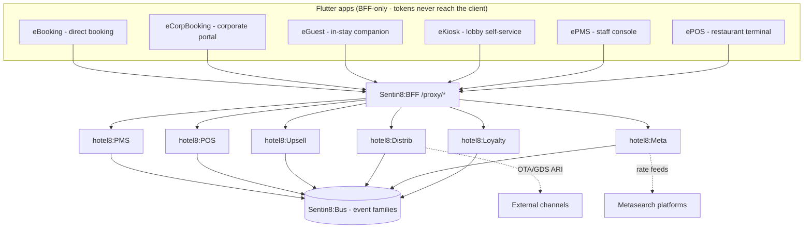

# hotel8 - Hospitality Vertical

> Secure Post-Quantum-Safe Hospitality Platform That Heals and Scales Itself.

[](LICENSE)
[](https://www.rust-lang.org/)
[](https://hotel8.dev)
[](https://hotel8.dev)

## 1. Summary

hotel8 is the hospitality vertical on the Sentin8 platform: six Rust services
(PMS, POS, Upsell, Distrib, Meta, Loyalty) that together run a hotel - the
property system of record, food-and-beverage point of sale, offer engine,
channel distribution, metasearch connectivity, and the loyalty program - and
six Flutter applications (eBooking, eCorpBooking, eGuest, eKiosk, ePMS, ePOS)
that put the same domain model in front of guests, corporate travel managers,
kiosk terminals, hotel staff, and restaurant staff. Every service shares one
vertical database (`hotel8`) with a schema per service, boots on the platform
`sentin8-shell`, authorizes through Shield (the platform declarative-policy
engine), and talks to the rest of the platform exclusively through Sentin8
platform services (Auth, BFF, Bus, DB, Storage, Post, Cron, Flow, Func, Sys).

Dependency direction is strictly one-way: sentin8 ← hotel8. The vertical never
patches the platform; the platform never references the vertical at compile
time (runtime registration via `vertical-registry.json` +
`services/catalog.json`).



## 2. Motivation

Hospitality software is fragmented: a property-management system, a restaurant
terminal, a loyalty engine, a channel manager, and a booking engine are
usually five vendors, five databases, and five integration contracts. hotel8
collapses that stack onto the platform's single identity plane (Sentin8:Auth),
one policy engine (Shield), one event bus (Sentin8:Bus), and one
tenant-isolated database - so the reservation a guest makes in eBooking is
the same row the front desk checks in, the restaurant posts a room charge
against, the loyalty engine awards points for, and the channels see within
seconds.

## 3. Services

| Service | Subdomain | Owns (schema) | One-line role |
|---|---|---|---|
| `hotel8:pms` | hotel8-pms | `pms` (36 tables) | Property system of record: rooms, rates, reservations, folios, housekeeping, blocks, events, night audit, digital keys, kiosk config, corporate accounts |
| `hotel8:pos` | hotel8-pos | `pos` (12 tables + outbox/audit) | Food-and-beverage point of sale: outlets, menus, checks, orders, payments (room charge → PMS folio), offline terminal sync |
| `hotel8:upsell` | hotel8-upsell | `upsell` (3 + 2) | Event-driven offer engine: rules-as-data, A/B testing, guest accept/decline, payment reflection |
| `hotel8:distrib` | hotel8-distrib | `distrib` (8 + 2) | Channel distribution: OTA/GDS onboarding, mappings, markup, ARI push, reservation intake |
| `hotel8:meta` | hotel8-meta | `meta` (6 + 2) | Metasearch connectivity: partner channels, rate ads, verification, click attribution |
| `hotel8:loyalty` | hotel8-loyalty | `loyalty` (6 + 2) | Rewards program: members, tiers, points ledger, redemption catalog, POS redemption |

Every service: `sentin8-shell` boot (PQ-TLS in-process, capped pool, Shield
hot-reload, outbox relay, audit pusher), RFW admin surface
(`/v1/admin/ui/{page}`), BFF proxy routes, and a per-service PostgreSQL-18
OAuth role (`hotel8_{svc}_service`) in the shared `hotel8` database.

## 4. Applications

| App | Users | Role |
|---|---|---|
| eBooking `apps/ebooking` | Guests | Direct commission-free booking funnel: search → room detail → checkout → confirmation; metasearch UTM attribution; loyalty join + vouchers; multi-property search |
| eCorpBooking `apps/ecorpbooking` | Corporate travel managers | Negotiated-rate portal: company-code login (+SSO), policy-guarded search, traveler roster, credit methods (post-pay / bill-to-company), multi-company switcher |
| eGuest `apps/eguest` | In-house guests | Stay companion: pre-registration, mobile check-in, room service ordering, upsell offers, rewards + saved payment methods, digital key, deep links |
| eKiosk `apps/ekiosk` | Lobby terminals | Self-service check-in/out with add-on sales and payment, walk-in express booking, lockdown mode; config-driven from PMS `kiosk-config` |
| ePMS `apps/epms` | Hotel staff | Property-management console: reservations, front desk, housekeeping, cashiering, rates, blocks, events, EOD; property switcher; sensitive-op re-auth |
| ePOS `apps/epos` | Restaurant staff | Table management, order entry, split/merge/transfer, payment incl. room charge, offline queue with idempotent replay, hardware abstraction (printer/drawer/terminal) |

All apps call the backend exclusively through `Sentin8:BFF /proxy/hotel8-*`
(the BFF holds OAuth tokens server-side); the shared Flutter infrastructure is
the platform package `sdk/flutter/sentin8`.

## 5. Structure

```
hotel8/
├── AGENTS.md                  # operating rules for AI agents
├── documents.md               # documentation specification (authority)
├── BACKLOG.md                 # the single vertical backlog
├── BUSINESS.md                # the vertical's business requirements
├── DESIGN.md                  # the vertical's detailed design
├── README.md                  # this file
├── Cargo.toml                 # workspace root
├── Makefile                   # build/test/doc/run targets (captain wrappers)
├── VERSION / CHANGELOG.md
├── vertical-registry.json     # service + app registration (vertical enroll)
├── crates/{pms,pos,upsell,distrib,meta,loyalty}/{client,contracts}/
│                              # typed HTTP clients + wire contracts
├── sdk/rust/hotel8/           # namespace facade: use hotel8::{svc}::{kind}
├── services/{pms,pos,upsell,distrib,meta,loyalty}/
│   ├── src/                   # one Rust service per directory (shell boot)
│   ├── sql/init.sql           # THE schema (single file - no migration files)
│   └── {README,DESIGN,BUSINESS}.md
├── apps/{ebooking,ecorpbooking,eguest,ekiosk,epms,epos}/
│   ├── lib/                   # Flutter app
│   └── {README,DESIGN,BUSINESS}.md
├── e2e-ts/                    # Playwright suites (browser-only, BFF proxy)
└── packaging/debian/          # deb packaging
```

## 6. Build, Test, Run

```bash
make build-rust      # cargo build --workspace --release (zero-warning gate)
make test-rust       # workspace tests (DB suite is DSN-gated)
make build-flutter   # all six apps
make lint            # clippy + fmt + flutter analyze
make doc             # rustdoc (zero-warning gate)

make vertical-init   # create hotel8 DB + apply per-service init.sql + roles
                     # (after `make infra-up` in the sentin8 workspace)
make vertical-enroll # register services + apps + scopes + catalog entries
make start / stop / status           # captain-managed fleet lifecycle
make upgrade-instance KEY=<ip:port>  # rolling zero-downtime swap
```

Rust compiles only via `make build-rust` (AGENTS.md); service restarts only
via the captain wrappers. See `DESIGN.md` §9 for the test strategy and
`e2e-ts/README.md` for the browser suites.

## 7. Dependencies

hotel8 depends on **sentin8** via relative path dependencies through the
namespace facade (`sdk/rust/hotel8` → `sentin8 = "0.1"` with the `.cargo`
patch shim). hotel8 does not depend on bank8, bill8, or health8 at the Rust
level - settlement rides Bill8 service HTTP APIs (M2M), never a code dep.

## 8. Documentation Map

| Want | Read |
|---|---|
| What the vertical does for the business | `BUSINESS.md` |
| How the vertical is built and why | `DESIGN.md` |
| One service's business requirements | `services/{svc}/BUSINESS.md` |
| One service's wire-level design | `services/{svc}/DESIGN.md` |
| One app's business requirements / design | `apps/{app}/BUSINESS.md` / `DESIGN.md` |
| Cross-service contracts (Rust) | `crates/{svc}/contracts`, `crates/{svc}/client` |
| Documentation rules | `documents.md`, `AGENTS.md` |

---

**Architecture & Design:** hotel8 and its underlying concepts were designed by [Hamid Jahanzad](https://www.linkedin.com/in/hamidjahanzad/).

## Website

The public website at **hotel8.dev** lives in the sibling
`hotel8-site` repo - Docusaurus v3 on `@sentin8/site-engine`, with
product/app/SDK pages and a Reference section harvested at build time
from these repositories (program design:
`../design/sentin8-websites-design.md`).
